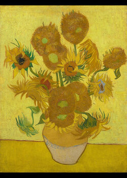
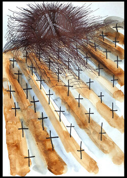
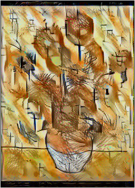

# Neural Style Transfer — VGG19 Feature-Based Image Content and Style Recombination

Optimisation-based neural style transfer: the system takes a **content image** and a **style image** and produces a third image that keeps the content image's structure while adopting the style image's texture, brushwork and palette. The recombination is driven by the feature activations of a pre-trained **VGG19** convolutional network.

The network itself is frozen and never updated, serving only as a fixed feature extractor. Pixels of the generated image are optimised, held as a `tf.Variable` and descended by Adam against a combined content-and-style cost. There is no dataset, as each output is the result of its own optimisation run.

Built with Python, TensorFlow and Keras. The images used to test the pipeline are drawn in part from the **Wartime Art Archive** ([website](https://waa.umca.art/en)): the style image is a wartime artwork from the archive, while the content image is a public-domain painting.

## Functionality

Execution of `main.py` loads both the content and the style image from `data_files/`, runs the optimisation loop, and writes the generated image back to the same folder as `result.png`.

| Step | What happens |
|---|---|
| 1 | Content and style images are loaded and preprocessed with VGG19's `preprocess_input` — ImageNet mean subtraction and BGR channel ordering — then expanded to a batch of one |
| 2 | VGG19 is loaded with ImageNet weights and `include_top=False`, then set to `trainable = False`, fixing it as a feature extractor |
| 3 | Feature taps are built from it: one **content model** reading `block5_conv2`, and three **style models** reading `block1_conv1`, `block3_conv2` and `block5_conv2` |
| 4 | The generated image is initialised as a `tf.Variable` copy of the content image, so the optimisation starts from the content rather than from noise |
| 5 | **Content cost** = mean squared difference between the content image's and the generated image's activations at the content layer |
| 6 | **Style cost** = mean squared difference between the *Gram matrices* of the style and generated activations, summed over the three style layers and weighted by `lam = 1 / number of style layers` so each layer contributes equally |
| 7 | **Total cost** = `alpha × content cost + beta × style cost`, with defaults `alpha = 10.0` and `beta = 20.0` |
| 8 | Gradients of the total cost are taken **with respect to the image** using `tf.GradientTape` and applied by Adam at a learning rate of `7.0` — a high rate, appropriate because the parameters being updated are pixel values rather than network weights |
| 9 | The loop runs for 100 iterations by default, tracking the lowest-cost iterate and returning that rather than the final one |
| 10 | The retained image is de-processed (channel order reversed, values clipped to `0–255`), then saved to `data_files/result.png` and displayed |

## Results

### 1 — Inputs

| Content | Style |
|---|---|
|  |  |

The content image supplies the structure to preserve: the vase, the arrangement of blooms, the division between table and background. The style image supplies the texture and palette to transfer: diagonal ochre, a scatter of dark cross motifs, and a dense tangle of radiating strokes at the top.

### 2 — Generated output

| Result |
|---|
|  |

- **Content preserved.** The vase, its neck and foot, the flower heads and the horizontal table edge all remain in position.
- **Style transferred.** The flat background is replaced by the style image's diagonal banding and the cross motifs are distributed across the canvas. The motifs appear at new positions and scales.

## Testing

**Prerequisites:** Python 3.11 or 3.12, and space for the VGG19 ImageNet weights, which Keras downloads and caches automatically on the first run.

**Steps:**

1. Create and activate a virtual environment, then `pip install -r requirements.txt`.
2. Place the two inputs in `data_files/` as `content.jpg` and `style.jpg`.
3. Run `python main.py`.
4. The cost and elapsed time are printed each iteration. The generated image is written to `data_files/result.png` and opened in a display window when the run completes.

> **Run time.** Each iteration requires a full forward and backward pass through VGG19, so a run of the default 100 iterations takes several minutes at the supplied resolution and scales with pixel count. Larger inputs are substantially slower.

To change the inputs, replace the two files in `data_files/`. To adjust the balance between structure content and style texture, change values in `training_process` (raising `beta` relative to `alpha` makes the result closer to style image, and lowering it preserves more of the content image).

## Repository layout

```
main.py                 Preprocessing, cost functions, optimisation loop and output
requirements.txt        Pinned dependencies
data_files/
  content.jpg           Content image — the structure to preserve
  style.jpg             Style image — the texture and palette to transfer
  result.png            Generated image written by the most recent run
```

## Tech stack

Python · TensorFlow 2.16 · Keras 3.1 · VGG19 (ImageNet weights) · NumPy · Matplotlib · Pillow

## Scope and limitations

- **One pair per run.** Content and style paths are resolved inside the script, so processing a different pair means replacing the files in `data_files/` or editing the paths.
- **No resizing.** Images are used at their native resolution. Cost scales with pixel count, so large inputs become slow quickly.
- **Uniform hyperparameters.** `alpha`, `beta`, the iteration count and the learning rate are fixed in the function. A different content–style pair will need different weights for better balance (current values were chosen for the testing pair).
- **The optimisation does not transfer.** The method optimises an image rather than training a network, restarting the full optimisation for every new pair. A feed-forward style-transfer network would be an improvement for repeated use with learning.
